--------------------------------------------------------------------------------
<div align="center">

  **Real-time Crazyflow simulations for ROS 2 and cflib2.**

  [](https://www.python.org)
  [](https://docs.ros.org/en/kilted)
  [](https://github.com/learnsyslab/crazyflow)
  [](https://github.com/bitcraze/crazyflie-lib-python-v2)
  [](https://pixi.sh)

</div>

Crazyflow ITL puts [Crazyflow](https://github.com/learnsyslab/crazyflow) in the loop of real drone software. It runs the sim in real time and connects it to [cflib2](https://github.com/bitcraze/crazyflie-lib-python-v2), ROS 2 and other clients. This makes code written for real Crazyflies testable in simulation. Crazyflow ITL is designed to be highly configurable, so you can run the simulation and connectors that your use-case needs.

```python
import sys
from contextlib import suppress

import rclpy
from crazyflow.sim import Sim
from rclpy.signals import SignalHandlerOptions

from crazyflow_itl import RealTimePlugin, run
from crazyflow_itl.crazyflie import CrazyfliePlugin
from crazyflow_itl.ros import TFPlugin

sim = Sim(n_drones=2, control="force_torque")  # CrazyfliePlugin handles controllers
rclpy.init(args=sys.argv, signal_handler_options=SignalHandlerOptions.NO)
node = rclpy.create_node("crazyflow_itl")
# Outputs, then timing, then inputs. cflib2 communicates with the drones on udp
plugins = [TFPlugin(node), RealTimePlugin(), CrazyfliePlugin()]
with suppress(KeyboardInterrupt):
    run(sim, plugins)
node.destroy_node()
rclpy.shutdown()
```

## Features

- **Configurable Crazyflow.** Configure Crazyflow as you need, including its step pipeline.
- **cflib2.** Simulated drones fly with the same code as real Crazyflies by changing the uri.
- **ROS 2.** Poses on TF, twists, sim time on `/clock`, commands and onboard camera images.
- **Real time or sim time.** You can run the sim in real time, as fast as it can, or step on request through [simulation_interfaces](https://github.com/ros-simulation/simulation_interfaces).
- **Plugins.** Plugins add outputs and inputs or reconfigure the sim before it runs.

## Installation

Crazyflow ITL uses [pixi](https://pixi.sh) and takes ROS 2 Kilted from RoboStack.

```bash
git clone https://github.com/amacati/crazyflow_itl.git
cd crazyflow_itl
pixi install
```

The `tests` environment adds pytest and cflib2, which it builds from source with UDP support, so its first install takes several minutes. The `gpu` environment adds the splat camera.

```bash
pixi install -e tests
pixi install -e gpu
```

## Examples

Each sim in `examples/` comes with a client that takes off, flies a square and lands.

| Example | Does |
| --- | --- |
| `ros_sim.py` | Broadcasts the poses of the drones on TF, publishes their twists and follows commands from ROS in real time. |
| `ros_client.py` | Streams commands along the flight to the drones of `ros_sim.py`, one per pose update on TF. |
| `crazyflie_sim.py` | Serves the drones to cflib2 clients over UDP and broadcasts their poses on TF like a motion capture system. |
| `crazyflie_client.py` | Flies the drones of `crazyflie_sim.py` with high-level `go_to` commands and logs their positions, as it would fly real Crazyflies. |
| `stepping_sim.py` | Publishes the sim time on `/clock`, broadcasts the poses on TF, follows commands from ROS and lets ROS clients pause, play and step the sim. |
| `stepping_client.py` | Commands the drones of `stepping_sim.py` to one waypoint at a time and steps the paused sim in between. |
| `launch_sim.py` | Starts `ros_sim.py` from a ROS launch with the argument `n_drones`. |

Start a sim in one terminal and its client in a second one. `--render` opens the MuJoCo viewer next to `ros_sim.py` and `crazyflie_sim.py`, and the cflib2 client runs in the `tests` environment, which holds cflib2.

```bash
pixi run sim --n_drones 2
pixi run python examples/ros_client.py

pixi run python examples/crazyflie_sim.py
pixi run -e tests python examples/crazyflie_client.py

pixi run python examples/stepping_sim.py --n_drones 2
pixi run python examples/stepping_client.py

pixi run ros2 launch examples/launch_sim.py n_drones:=2
```

## Plugins

`run(sim, plugins)` steps the sim and calls each plugin at its own rate. You can reconfigure the sim before it runs, for example by inserting a jit-compatible stage into Crazyflow's step pipeline.

```python
class HeightPlugin:
    freq = 10  # Hz

    def setup(self, sim):
        return sim

    def step(self, sim):
        print(sim.data.states.pos[0, :, 2])
        return sim

    def close(self):
        pass
```

Plugins run in list order, so queue outputs first, then the plugin that paces the sim, and then inputs. Crazyflow ITL comes with the following plugins:

| Plugin | Does |
| --- | --- |
| `TFPlugin`, `TwistPlugin` | Publish drone poses on TF and their velocities as twists. |
| `ClockPlugin` | Publish the sim time on `/clock`. |
| `CommandPlugin` | Apply commands from ROS topics. |
| `SpinPlugin` | Run the callbacks of a ROS node. |
| `RealTimePlugin` | Keep the sim in step with the wall clock. |
| `SteppingPlugin` | Pause, play and step the sim through [simulation_interfaces](https://github.com/ros-simulation/simulation_interfaces). |
| `CrazyfliePlugin` | Control the crazyflies with cflib2. |
| `SplatCameraPlugin` | Stream onboard camera images rendered from Gaussian splats. |
| `RenderPlugin` | Show the sim in the MuJoCo viewer. |

## Testing

```bash
pixi run tests
```
